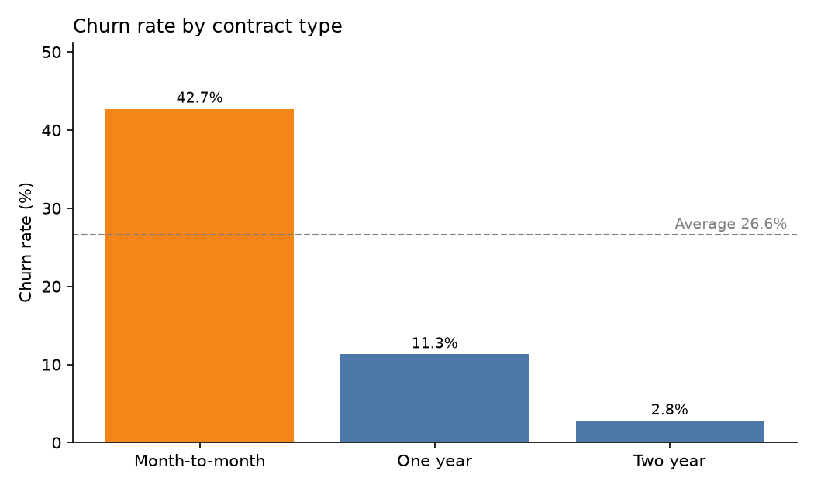
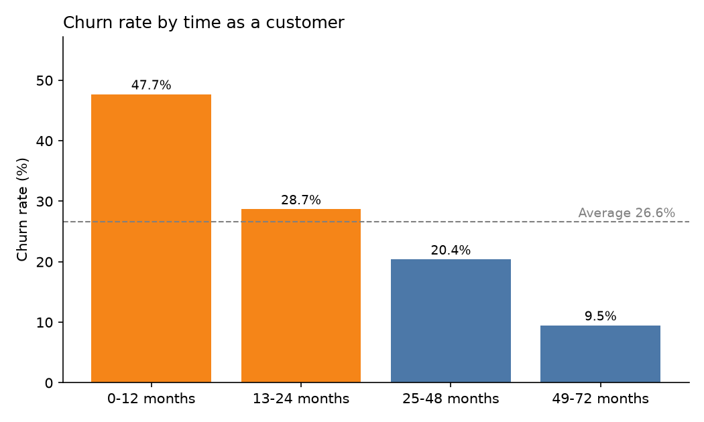

# Telco Customer Churn Analysis (Python)

**Question:** Which customers are leaving a telecom company, and what do they have in common?

This project analyzes 7,032 customers to find the main drivers of churn and size the revenue at risk, then recommends retention actions.

## Data
- Dataset: [Telco Customer Churn](https://www.kaggle.com/datasets/blastchar/telco-customer-churn) (Kaggle, IBM sample data)
- 7,043 customers; 11 rows with a blank `TotalCharges` (new customers with tenure 0) were removed, leaving **7,032**.
- Each row is one customer: contract, tenure, services, payment method, monthly charges, and whether they churned.

## Method
- Python (pandas, matplotlib).
- Cleaned the data: converted `TotalCharges` to numeric, removed blank rows, checked for duplicates, created a churn flag.
- Grouped customers by contract, tenure, internet service, payment method, monthly charges, tech support and senior citizen status, and compared churn rates with the overall average.
- Looked at the highest-risk segment and the monthly revenue tied to churned customers.

## Key findings
Overall churn rate: **26.6%**.

| Factor | Higher-churn group | Lower-churn group |
|---|---|---|
| Contract | Month-to-month: **42.7%** | One year: 11.3%, Two year: **2.8%** |
| Tenure | 0-12 months: **47.7%** | 49-72 months: 9.5% |
| Internet service | Fiber optic: **41.9%** | DSL: 19.0% |
| Payment method | Electronic check: **45.3%** | Automatic payments: 15.3-16.7% |
| Tech support | No: **41.6%** | Yes: 15.2% |
| Senior citizen | Yes: 41.7% | No: 23.7% |

1. **Contract type is the biggest driver.** Month-to-month customers churn about 15 times as often as two-year customers.
2. **The first year is the riskiest.** Nearly half of customers in their first 12 months leave.
3. **A high-risk segment stands out.** Month-to-month + Fiber optic + Electronic check customers are 18.6% of the base (1,307 customers) but churn at **60.4%**.
4. **Churn is costly.** Churned customers account for **30.5%** of total monthly revenue, and they pay more per month on average (74.4 vs 61.3) than customers who stay.

## Charts




## Recommendations
1. **Move customers to longer contracts.** Offer discounts or perks to month-to-month customers who switch to a one- or two-year plan.
2. **Focus on the first 12 months.** Add onboarding calls, check-ins and early-tenure offers.
3. **Target the high-risk segment.** Encourage fiber customers to switch to automatic payment and bundle tech support.

## Limitations
- This is a snapshot, so the analysis shows association, not proof of cause.
- The analysis is descriptive. It does not include a predictive model.
- The dataset is a sample dataset and not real company data.

## How to run
```
pip3 install pandas matplotlib
python3 telco_churn_project.py /path/to/WA_Fn-UseC_-Telco-Customer-Churn.csv
```
Charts and results.txt are saved in a folder called churn_output when you run the script. The CSV is not included; download it from the Kaggle link above.

## Tools
Python, pandas, matplotlib
